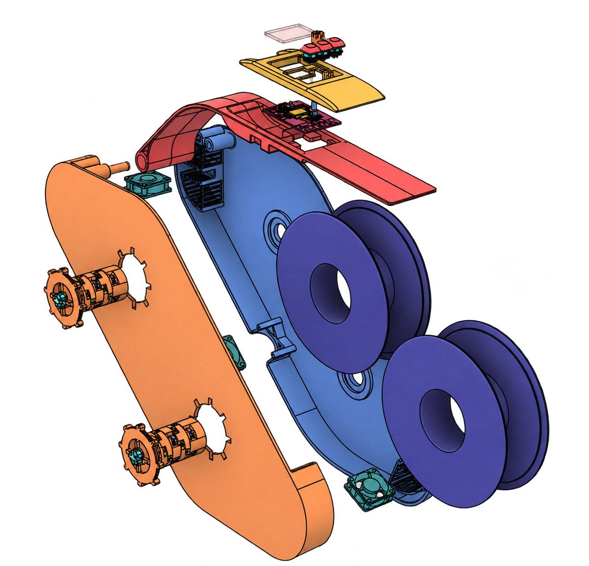

# Cinder - A filament dryer!

&nbsp;

&nbsp;

&nbsp;

&nbsp;

#### To-Do-List:
1. Make fusion 3D Renders
3. What Cinder is, why you built it, and what you wanted to improve over your previous dryer. Put your best render or finished-build photo here.
4. What is finished, what has been tested, and what still needs work. Distinguish planned features from working ones.
5. Explain the path of the air and filament, how the heaters and fans work together, and how the controller uses sensor readings. A labeled diagram would help.
6. Specifications	Dimensions, supported spool sizes, power requirements, heater power, and other confirmed specifications. Label design targets separately from measurements.
7. An overview of the tools, skills, materials, and steps needed to build one.
8. Bill of materials	Parts, quantities, exact part numbers, supplier links, and approximate costs. Include screws, inserts, connectors, and wiring.
9. Printing and fabrication	Which files to print, material choices, orientation, supports, tolerances, and any laser-cut parts. Include settings you actually tested.
10. Assembly	Numbered instructions with photos or renders, covering the enclosure, spool mechanism, heaters, fans, and electronics.
11. Electronics and wiring	PCB overview, schematic, connector labels, wiring diagram, pin assignments, supply requirements, and board revisions.
12. Firmware and setup	How to build and flash the firmware, required tools or libraries, configuration, and sensor calibration.
13. Using Cinder	What the buttons and display do, how to load filament, start a drying cycle, and stop the machine.
14. Safety	Heater mounting, electrical protection, temperature limits, and any implemented fault handling. Be clear about protections that are still planned or untested.
15. Known issues and troubleshooting	Problems you have found, symptoms others might encounter, workarounds, and fixes.
16. Use of clip connectors

## Contents 

- [Overview](#overview)
    - [Features](#features)
    - [Design Issues](#design-issues)
    - [Firmware](#firmware)
    - [PCB](#pcb)
    - [Specification](#specification)
- [Make your own!](#make-your-own)
    - [Bill of materials](#bill-of-materials)
    - [Printing](#printing)
    - [Electronics & Wiring](#electronics--wiring)
    - [Assembly](#assembly)
- [Showcase](#showcase)

## Overview

### Features
### Design Issues
### Features
### PCB
### Firmware
### Specification

## Make your own!

### Bill of materials
### Printing
### Electronics & Wiring
### Assembly

## Showcase

This is a fully functional filament dryer 

The cinder filament dryer is a self managed ecosystem comprising of 2 45W heaters powered from a 90W+ power supply to provide the most heating power possible. In addition to that, there is also space for 3 possible fans with silica gel pouch to aid in the airflow and dryer performance. Equiped with an SHT40 module, you will always be 110% aware of exactly how long your filament will take to dry and at what temperature and with a 90W heater, I can guarantee that won't be long ;). Also comes in a cool, tilted design with a fancy flame aesthetic on the side, it also utilizes a smart locking system that adapts the arm of the spool holder to the width of the spool hole, this way, you can ensure the spool is free to spin properly and doesn't scratch the heating element. And if that isn't enough filament flow for you, there is also a dedicated servo driving system and filament extrusion rate feedback integration that automatically pushes out the strand of filament so that the printer, or you, don't have to worry about printing while drying. Comes with a 128x64 OLED, 3 buttons and an encoder for all your "control panel" needs because, we all love fancy control panels don't we? The frame itself is designed to be easy to print (albeit quite large) and assemble. And not to mention with the amazing aesthetic comes a super cool futuristic, pod like door system that lifts upwars on a big pin hinge to allow you to remove the spools or insert more. And obviously, we don't want tipping dryers so, on another pin hinge, we have a leg that can be bent backwards flush to the device when the dryer is hung on the wall or extended so that it literally doesn't fall over.

Some CAD images:

 

### How Cinder fits together

The cinder filament dryer is a self managed ecosystem comprising of 2 45W heaters powered from a 90W+ power supply to provide the most heating power possible. In addition to that, there is also space for 3 possible fans with silica gel pouch to aid in the airflow and dryer performance. Equiped with an SHT40 module, you will always be 110% aware of exactly how long your filament will take to dry and at what temperature and with a 90W heater, I can guarantee that won't be long ;). Also comes in a cool, tilted design with a fancy flame aesthetic on the side, it also utilizes a smart locking system that adapts the arm of the spool holder to the width of the spool hole, this way, you can ensure the spool is free to spin properly and doesn't scratch the heating element. And if that isn't enough filament flow for you, there is also a dedicated servo driving system and filament extrusion rate feedback integration that automatically pushes out the strand of filament so that the printer, or you, don't have to worry about printing while drying. Comes with a 128x64 OLED, 3 buttons and an encoder for all your "control panel" needs because, we all love fancy control panels don't we? The frame itself is designed to be easy to print (albeit quite large) and assemble. And not to mention with the amazing aesthetic comes a super cool futuristic, pod like door system that lifts upwars on a big pin hinge to allow you to remove the spools or insert more. And obviously, we don't want tipping dryers so, on another pin hinge, we have a leg that can be bent backwards flush to the device when the dryer is hung on the wall or extended so that it literally doesn't fall over.

 

## Features:
- It drys filament (duh)
- 90W heating power
- OLED display control panel with 3 buttons, encoder and a cool acrylic view panel
- Leg (pretty simple) to hold it from falling backwards
- Fully integrated PCB that drives the 90W heaters, stepper motor driver, OLED, buttons and connectors for all the other sensors.
- Filament pushing system with extruding feedback to maintain proper filament pushing flow
- Easy to assemble
- Airflow powered by 3 5020 fans (LOTS of airflow)
- Spaces for silica gel pouches
- Fancy, cool looking tilted design with flame aesthetics
- Automatic locking system for holding the spool with an arm extendible in diameter TM
- PWM control of fans and heater

## PCB
And this is my main PCB. A bit budget restrained otherwise so I had to use some premade sensor modules, the actual flex heater PCB is pretty simple so I won't bother putting it here (but it's in the files):

  

And the Schematic:

And here are some 3D views as well:

## Firmware Overview
At the current moment there is some, untested firmware in there that's supposed to have the dryer functioning but, I don't actually have it yet so I can't test, in future I will program it properly.

## BOM:

- The actual print (alot, probably like 1-2kg+)
- The main PCB (check KiCad files for all the components and external modules)
- 3 5020 fans
- A stepper motor
- Some lasercut acrylic
- MX keycaps (3)
- Some M2 heated inserts and bolts to hold the whole thing togethor
